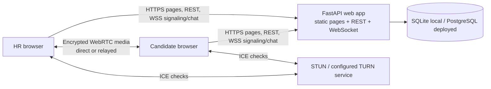
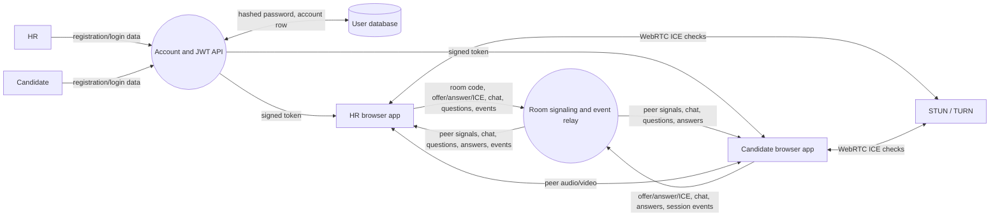
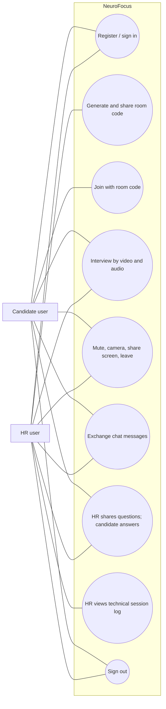
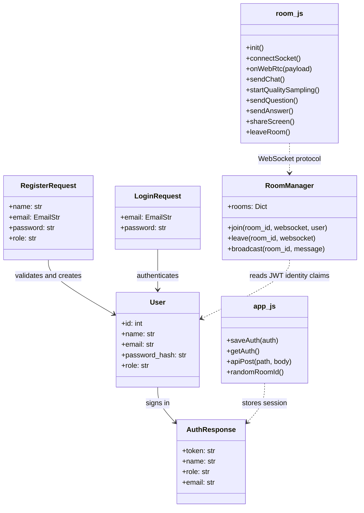

# NeuroFocus architecture and verification record

These diagrams reflect the current source code. The backend is `backend/main.py`; the browser pages and scripts live under `frontend/`.

## System Architecture

The signaling service relays offer/answer/ICE messages. Browsers exchange audio/video over WebRTC; media is not routed through FastAPI. TURN is an optional relay path configured by environment variables. Room membership is in memory, so this build expects one app process.

## Data Flow Diagram

## Use Case Diagram

## Class / Module Diagram

## Test Case Table

This log reflects the automated smoke run on 2026-10-13. Browser media, actual video negotiation, TURN use, and deployment checks still require manual execution. Fill in Evidence with the result/date/device/network after each manual check; do not treat a partial API check as a browser-level pass.

| Test Case ID | Scenario | Input / Action | Expected Output | Actual Status | Evidence |
|---|---|---|---|---|---|
| NF-01 | Register HR | Valid name, unused email, password ≥8 chars, HR role | Account row and JWT returned | Passed (API smoke test) | `backend/smoke_test.py`, 2026-10-12 |
| NF-02 | Register Candidate | Valid name, unused email, password ≥8 chars, Candidate role | Account row and JWT returned | Passed (API smoke test) | `backend/smoke_test.py`, 2026-10-12 |
| NF-03 | Duplicate registration | Reuse registered email | HTTP 409 with clear message | Passed (API smoke test) | `backend/smoke_test.py`, 2026-10-12 |
| NF-04 | Invalid login | Wrong password | HTTP 401; no token | Passed (API smoke test) | `backend/smoke_test.py`, 2026-10-12 |
| NF-05 | Authenticated session | Request `/api/me` with returned Bearer token | Signed-in identity returned | Passed (API smoke test) | `backend/smoke_test.py`, 2026-10-12 |
| NF-06 | HR creates room | Generate room code, join as HR | Interview page joins and waits | Partial: protected code creation and invalid code tested; browser flow not tested | `backend/smoke_test.py`, 2026-10-12 |
| NF-07 | Delayed candidate join | HR waits at least 15 seconds, Candidate then joins | Offer is created after Candidate presence; connection reaches connected | Partial: 15-second WebSocket peer notification tested; browser WebRTC not tested | `backend/smoke_test.py`, 2026-10-12 |
| NF-08 | Reverse join order | Candidate first, HR second | Room snapshot lets HR initiate negotiation | Partial: reverse-order peer snapshot tested; browser WebRTC not tested | `backend/smoke_test.py`, 2026-10-12 |
| NF-09 | Role/seat cap | Add second HR or third participant | Extra socket is rejected with room-full message | Passed: third WebSocket rejected | `backend/smoke_test.py`, 2026-10-12 |
| NF-10 | Chat attribution | Send one message from each role | Other side sees one message with correct sender/role | Partial: Candidate-to-HR relay tested | `backend/smoke_test.py`, 2026-10-12 |
| NF-11 | Session event relay | Candidate changes tab or media state | HR sees timestamped context-only event; no automated score | Passed: API/WebSocket relay tested | `backend/smoke_test.py`, 2026-10-13 |
| NF-12 | Media controls and leave | Toggle mic/camera; leave one side | Both cameras and mics toggle and peer sees state; peer gets leave event | Partial: signaling and peer-left tested; browser controls/media not tested | `backend/smoke_test.py`, 2026-10-13 |
| NF-13 | Media permission denied | Deny camera and microphone | Clear browser message; app does not silently crash | Not run | — |
| NF-14 | TURN configuration | Set TURN env values and inspect ICE server endpoint | Signed-in users receive ICE config; candidate pair shows relay when selected | Partial: unauthenticated config denied and STUN-only response tested; provider credentials/candidate pair not tested | `backend/smoke_test.py`, 2026-10-13 |
| NF-15 | Cross-network call | One device Wi-Fi, one device mobile data | Both media directions connect; record candidate pair type | Not run | — |
| NF-16 | Deployed service | Run flows against HTTPS deployment | Health, auth, room, chat, and video work on deployed URL | Not run | — |
| NF-17 | Interview questions and answers | HR sends a coding question; candidate submits an answer | Both roles see the correct question and response | Passed: WebSocket relay tested | `backend/smoke_test.py`, 2026-10-13 |
| NF-18 | Screen sharing | Either participant starts and stops sharing | Remote peer sees share state; media renegotiates | Partial: signaling path available; browser media not tested | `backend/smoke_test.py`, 2026-10-13 |
| NF-19 | Media state permissions | Candidate attempts to send an HR camera state; each role changes own camera state | Spoofed role event is ignored; permitted camera state reaches the other participant | Passed: WebSocket role/state checks | `backend/smoke_test.py`, 2026-10-13 |
| NF-20 | Answer validation | Submit an unknown question ID or answer twice | Backend rejects unknown/duplicate answers; valid answer reaches HR with a language label | Passed: WebSocket validation tested | `backend/smoke_test.py`, 2026-10-13 |
| NF-21 | Production HR registration | Register HR without invite, then with configured invite | Missing invite rejected; valid invite accepted; candidates can register normally | Passed: API smoke test | `backend/smoke_test.py`, 2026-10-13 |
| NF-22 | ICE restart signaling | Candidate requests normal renegotiation and ICE restart | Authenticated room relay preserves restart flag for HR offerer | Passed: WebSocket smoke test | `backend/smoke_test.py`, 2026-10-13 |

